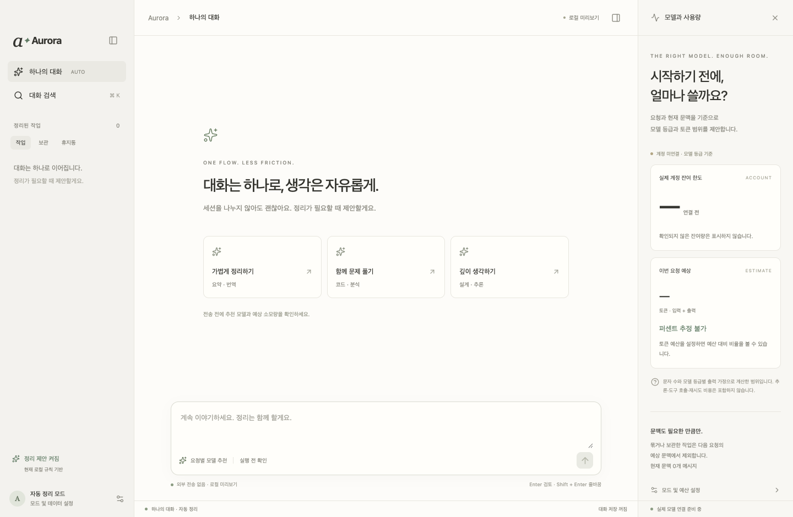

# Aurora

작업 범위와 예상 토큰을 검토한 뒤 실행 여부를 결정하는 데스크톱 AI 작업 공간.
이름은 *Auto Router · Low AI*에서 가져왔습니다.

**개발 프리뷰 · MIT**

## 다운로드

[](https://github.com/uiwwsw/aurora/releases/download/v0.1.1/Aurora-0.1.1-mac-arm64.dmg)
[](https://github.com/uiwwsw/aurora/releases/download/v0.1.1/Aurora-0.1.1-mac-x64.dmg)
[](https://github.com/uiwwsw/aurora/releases/download/v0.1.1/Aurora-0.1.1-windows-x64.exe)

[릴리스 · ZIP · 체크섬](https://github.com/uiwwsw/aurora/releases/tag/v0.1.1)

macOS는 DMG에서 Aurora를 Applications 폴더로 옮기고, Windows는 EXE 설치 프로그램을 실행합니다. **Node.js는 필요하지 않습니다.**
macOS는 ad-hoc 서명이며 Developer ID 서명·공증은 없습니다. Windows도 개발자 인증서 미서명 상태로, 운영체제의 보안 확인 또는 실행 제한이 나타날 수 있습니다.




## 소개

Aurora는 요청의 범위, 사용할 모델, 예상 소모량을 먼저 확인하는 흐름을 실험합니다.
하나의 대화에서 작업을 이어가고, 정리가 필요하면 이전 내용을 묶거나 보관합니다.
세션을 직접 관리하는 레거시 모드도 제공합니다.

기본은 로컬 미리보기입니다. 현재 main에는 OpenAI·Anthropic API 어댑터와 역할별 모델 설정이 추가되어 있습니다.
실제 API 키로 호출하는 라이브 검증과 계정 잔여 한도 연동은 아직 하지 않았습니다.

## 기능

- 하나의 대화 흐름과 작업 묶음, 보관·휴지통·복원
- 직접 세션을 생성하고 전환하는 레거시 모드
- 내부 분석 모델과 기본 실행 모델의 독립 설정
- 요청마다 실행 모델을 선택하고 예상 입력·출력 토큰 검토
- API 키가 있을 때 별도 내부 분석과 텍스트 답변 실행
- 계획용 토큰 예산 대비 비율 표시
- 검색, 선택적 로컬 저장, 라이트·다크 테마

자동 정리는 로컬 규칙으로 동작합니다. 내부 분석은 명시적으로 요청해야 모델을 호출합니다.
실행 모델은 사용자가 선택하며, 현재는 텍스트 답변만 지원합니다. 파일 수정·셸 실행은 하지 않습니다.

## 소스에서 실행

Node.js 24 이상과 npm이 필요합니다.

```bash
git clone https://github.com/uiwwsw/aurora.git
cd aurora
npm ci
npm start
```

Electron + React + TypeScript로 구성되어 있으며 별도 웹 서버 없이 실행합니다.
미리보기에는 API 키가 필요하지 않습니다. 일반 사용자는 위의 설치 파일을 사용하면 됩니다.

## 모델 설정과 API 연결

| 기본 구성 | 내부 분석·추천 | 기본 실행 모델 |
| --- | --- | --- |
| OpenAI | GPT-6 Luna (`gpt-6-luna`) | GPT-6.1 Sol (`gpt-6.1-sol`) |
| Claude | Claude Haiku 5.5 (`claude-haiku-5-5`) | Claude Sonnet 5.5 (`claude-sonnet-5-5`) |

설정에서 두 역할을 독립적으로 바꿀 수 있습니다. 제공자를 조합할 수도 있고, 실행 모델은 요청마다 다시 선택합니다.
모델 설정은 대화 저장과 별도로 기기에 유지합니다.

1. 소스 실행에서는 `.env.example`을 `.env`로 복사합니다. 설치 앱에서는 앱 데이터 폴더(macOS: `~/Library/Application Support/Aurora`, Windows: `%APPDATA%/Aurora`)에 `.env`를 만들고 사용할 제공자의 `OPENAI_API_KEY` 또는 `ANTHROPIC_API_KEY`를 설정합니다. 환경변수로 전달해도 됩니다.
2. 앱을 재시작하고 설정에서 **실제 API 사용**을 켭니다. 이 스위치만으로 요청을 전송하지는 않습니다.
3. 검토창에서 **내부 모델로 분석**을 누르면 요청과 현재 문맥을 분석 모델에 전송합니다. 분석에도 별도 사용량이 발생합니다.
4. 추천을 확인하고 실행 모델을 고른 뒤 **선택한 모델로 API 실행**을 누릅니다. 분석을 건너뛰고 직접 선택할 수도 있습니다.

키 감지는 연결이나 모델 접근 성공의 검증이 아닙니다. 실패 시 자동 재시도하거나 다른 모델로 바꾸지 않습니다.
키 값은 renderer나 대화 저장소로 전달하지 않으며 `.env`는 Git에서 제외합니다.
이 구현은 API 키 방식이며 ChatGPT·Claude 웹 로그인은 구현하지 않았습니다.

모델 목록 확인: [OpenAI](https://developers.openai.com/api/docs/models), [Claude](https://platform.claude.com/docs/en/models/overview) (2026-10-19).
계정별 접근 권한은 실제 API에서 확인해야 합니다.

## 토큰과 예산

모델별 비교 수치는 아직 실측이나 내부 모델의 토큰 예측이 아닌 **문자 수와 등급별 출력 가정**입니다.
같은 등급에는 같은 범위를 표시합니다. 내부 모델은 작업 범위와 모델 추천을 제공하며, 정량 예측은 후속 작업입니다.
계획용 예산의 %는 직접 입력한 토큰 예산 대비 비율이며 구독 한도의 %가 아닙니다.
API 응답의 실제 입력·출력 사용량은 예상치와 구분해 표시합니다.

호출별 생성 상한은 내부 분석 2,048토큰, 본 작업 4,096토큰입니다. 입력은 별도이며, 이 상한은 전체 작업의 토큰·비용 예산이 아닙니다.
출력·추론·도구 호출·재시도량을 사전에 확정할 수 없으며 상한에 도달하면 응답이 미완성으로 끝날 수 있습니다.
**정해진 토큰으로 기능 완성을 보장하지 않습니다.** 전체 작업 예산의 강제 제한은 아직 구현하지 않았습니다.

관련 설계와 근거는 [실행 예산 설계](docs/product-vision.md)에 정리했습니다.

## 개발

```bash
npm run build          # 타입 검사 및 프런트엔드 빌드
npm test               # 도메인·API 어댑터 테스트
npm run test:desktop   # Electron UI 테스트
npm run package:mac    # macOS DMG·ZIP
npm run package:win    # Windows x64 EXE (Windows에서 빌드)
```

macOS·Windows CI에서 빌드와 단위 테스트를 검증합니다. 태그 릴리스 파이프라인은 macOS arm64·x64와 Windows x64 설치 파일을 네이티브 러너에서 만들고, 설치 후 실행 검증을 통과한 파일만 공개합니다.
API 테스트는 가짜 응답을 사용하며 실제 키나 과금 요청을 사용하지 않습니다.
관리자의 SSD 환경에서는 npm 명령 앞에 `./dev`를 사용합니다.

## 릴리스 자동화

`v`로 시작하는 버전 태그를 푸시하면 GitHub Actions가 테스트 → 패키징 → 설치·실행 확인 → 릴리스 첨부를 수행합니다. 태그와 package.json 버전이 일치해야 하며 세 플랫폼 검증이 모두 성공해야 공개합니다. 릴리스에는 SHA-256 체크섬과 서명 상태를 기록한 manifest가 포함됩니다. 공개된 설치 파일은 같은 태그로 덮어쓰지 않습니다. 자세한 절차는 [릴리스 문서](docs/releases.md)를 참고하세요.

## 다음 단계

- 실제 키를 사용하는 제공자 호출과 사용량 검증
- 입력 토큰 계산과 실행 기록에 기반한 정량 추정
- 작업 범위·완료 조건 확인과 단계별 예산 승인
- 모델 추천과 자동 정리의 품질 평가
- 배포 인증서 서명·macOS 공증과 앱 내 자동 업데이트

## 데이터

미리보기에서는 외부로 요청을 전송하지 않습니다. API 모드에서는 분석·실행 버튼을 눌렀을 때 선택한 제공자에게 요청과 해당 문맥을 전송합니다.
대화 저장은 기본 꺼짐이며, 켜면 이 기기에 기록합니다. 암호화 보관함은 아닙니다.
저장을 끄면 저장 사본은 제거하고 현재 창의 대화는 유지합니다.

## 기여

버그와 제안은 [Issues](https://github.com/uiwwsw/aurora/issues), 변경 절차는 [CONTRIBUTING.md](CONTRIBUTING.md)를 참고하세요.

## 라이선스

[MIT](LICENSE)
