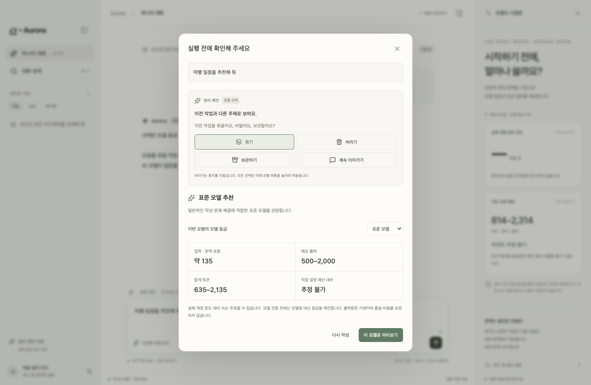

<div align="center">

# Aurora ✦

**“이 정도의 토큰이 들 것으로 예상됩니다. 진행할까요?”**

Auto Router · Low AI

[](https://github.com/uiwwsw/aurora/releases/tag/v0.1.0)
[](LICENSE)
[](CONTRIBUTING.md)

An AI workspace that explains the intended work and estimated tokens before you choose to run it. Contributors welcome.

</div>

## 실행하기 전에, 먼저 선택할 수 있도록

> “이 정도의 토큰이 들 것으로 예상됩니다. 진행할까요?”

원하는 기능을 제대로 이해했는지, 결과가 쓸모 있을지 확인하기도 전에 AI 작업이 실행되고 사용량이 쌓이는 경험에서 출발했습니다. 오로라가 만들고 싶은 것은 **실행 전에 할 일과 예상 토큰을 설명하고, 사용자가 그 작업을 진행할지 결정하는 AI 작업 공간**입니다.

AI가 더 많은 일을 맡게 될수록, 한 번의 요청이 어디까지 이어지고 얼마나 소모할지 먼저 이해할 수 있어야 한다고 생각합니다. 모브는 이 선택권을 AI 작업의 시작점에 두려 합니다.

### 만들고 싶은 흐름

1. 사용자가 원하는 결과를 말합니다.
2. 오로라가 이해한 작업 범위와 결과를 설명합니다. 의도가 맞는지 사용자가 확인하고 수정합니다.
3. 실행에 예상되는 토큰 범위와 추정 근거를 보여줍니다. 작업 범위나 모델을 바꾸면 다시 검토합니다.
4. 사용자가 “이 정도면 진행하겠다”고 선택한 뒤 실제 작업을 시작합니다.

토큰은 실행 전의 **예상 범위**입니다. 실제 사용량을 정확히 보장하는 견적처럼 표현하지 않으며, 추정이 어려운 부분도 함께 알려주는 경험을 만들고자 합니다. 대화 정리와 모델 추천은 이 선택을 돕는 기능입니다.

### 함께 만들 컨트리뷰터를 찾습니다

이 방향에 공감하는 분들의 도움을 기다립니다. 특히 요청의 의도를 확인하는 UX, 실행 전 토큰 추정, 모델·도구 연결, 예상과 실제 사용량의 비교에 관심 있는 분들과 함께 만들고 싶습니다. 코드, 디자인, 평가 사례, 문서, 플랫폼 테스트 기여를 환영합니다. 이 저장소의 Issues와 Pull requests로 의견과 작업을 나눠 주세요.

**현재는 개발 중인 로컬 프로토타입입니다.** 모델 등급·토큰 범위 검토와 대화 정리 흐름을 실험하고 있습니다. 실제 AI 실행과 계정 사용량 연결, 위 흐름의 완성은 앞으로의 작업입니다.


## 무엇을 만들고 있나요?

Aurora(오로라)는 **“오토 라우터 · 로우 에이아이”**에서 이름을 가져왔습니다.
**실행 전에 작업 의도와 예상 토큰을 확인하고 진행 여부를 선택하는** 데스크톱 AI 작업 공간을 만들고 있습니다. 모델 추천과 대화 정리는 그 판단을 돕는 기능입니다.

우리가 만들려는 경험은 이렇습니다.

- **대화는 하나로.** 사용자가 매번 세션을 나누지 않고 계속 이야기합니다.
- **정리는 AI와 함께.** 주제 전환이나 작업 완료를 감지해 “묶을까요, 버릴까요, 보관할까요?”라고 제안합니다. 사용자가 선택하면 정리합니다.
- **실행 전에 비용을 이해하도록.** 적절한 모델, 추천 이유, 예상 토큰과 근거 있는 사용 한도 비율을 먼저 알려줍니다.
- **직접 관리할 자유도.** 자동 정리가 필요 없으면 레거시 모드에서 세션을 직접 만듭니다.

목표 플랫폼은 **macOS와 Windows**입니다. Electron + React + TypeScript로 개발합니다.
Aurora는 독립 프로젝트이며 OpenAI·Codex의 공식 제품이 아닙니다.

## v0.1.0 — 어디까지 구현했나요?

**이번 버전은 소스에서 실행하는 로컬 워크플로 프로토타입입니다.** 실제 AI에 요청을 보내는 완성된 클라이언트나 설치형 앱 배포본은 아직 아닙니다.

| 기능 | v0.1.0 상태 |
| --- | --- |
| 하나의 연속 대화와 작업 묶음 | 구현 |
| 묶기·보관·휴지통·복원 | 구현, 진행 확인 후 적용 |
| 정리 시점 감지 | 로컬 규칙 기반. 실제 AI 판단은 후속 작업 |
| 레거시 모드 | 직접 세션 생성·전환, 자동 정리 꺼짐 |
| 모델 추천 | 경량·표준·고성능 등급과 이유. 실제 모델명·호출은 미연결 |
| 토큰 예상 | 현재 문맥 포함 입력 + 출력 가정의 범위 |
| 퍼센트 예상 | 직접 설정한 계획용 토큰 예산 대비 %. 계정 한도와 구분 |
| 실제 계정 잔여량·한도 대비 % | 미연결·추정 불가 |
| 로컬 저장·검색·라이트/다크 테마 | 구현, 대화 저장 기본 꺼짐 |
| 플랫폼 검증 | macOS 실행 검증. Windows 실행·설치 패키지는 아직 미검증 |



### 추정치는 어떻게 읽어야 하나요?

토큰 수는 문자 수와 모델 등급별 출력 가정으로 계산한 근사 범위입니다. 실제 토크나이저·추론·도구 호출·재시도 비용은 반영하지 않습니다.
계정 잔여 비율만으로 토큰을 임의 환산하지 않으며, 근거가 없으면 **추정 불가**로 표시합니다.
계획용 예산의 %는 사용자가 직접 입력한 토큰 예산 대비 비율이며, 구독 한도의 %가 아닙니다.
현재 진행 버튼은 로컬 미리보기만 생성합니다. 질문을 AI가 수행하거나 실제 한도를 차감하지 않습니다.

## 시작하기

필요한 환경: **Node.js 24 이상, npm, Git**. 현재 프로토타입에는 API 키나 로그인이 필요하지 않습니다.

```bash
git clone https://github.com/uiwwsw/aurora.git
cd aurora
npm ci
npm start
```

웹 서버 없이 Electron의 `aurora://app`으로 로컬 화면을 엽니다.
의존성은 잠금 파일을 기준으로 설치하세요. 설치 중 신뢰할 수 있는 패키지의 스크립트 승인이 필요한 환경이라면 npm 안내를 확인하세요.

> 저장소 관리자의 SSD 개발 환경에서는 위 npm 명령을 `./dev npm …`으로 실행합니다. 외부 기여자는 이 래퍼 없이 일반 npm 명령을 사용하면 됩니다.

## 사용 흐름

1. 하나의 대화에서 요청을 작성합니다.
2. **요청 검토**에서 추천 모델 등급과 예상 입력·출력·합계를 확인합니다. 모델 등급을 바꿀 수도 있습니다.
3. 정리 제안이 있으면 이전 작업을 묶기·버리기·보관·유지 중 선택합니다. 검토를 취소하면 상태는 바뀌지 않습니다.
4. **이 모델로 미리보기**를 누르면 요청을 기록합니다. 버린 작업은 휴지통에서 복원할 수 있습니다.
5. 설정에서 레거시 모드를 선택하면 직접 세션을 관리합니다. 두 모드의 대화는 별도로 유지됩니다.

묶거나 보관하거나 버린 작업은 다음 요청의 예상 문맥에서 제외합니다. 복원은 묶음으로 되돌리며 문맥에 자동 포함하지 않습니다.

## 로드맵

- [x] 데스크톱 기본 레이아웃과 하나의 대화 흐름
- [x] 로컬 정리 제안·보관·복원과 레거시 모드
- [x] 실행 전 모델 등급·토큰·계획 예산 비율 검토
- [ ] 실제 모델 제공자 연결과 구체적인 모델 카탈로그
- [ ] 실제 AI의 작업 분류·정리 제안
- [ ] 허용된 인증·사용량 데이터 연동과 검증된 한도 환산
- [ ] 사용자 피드백과 품질 평가에 기반한 모델 추천
- [ ] 사용자가 허용한 범위의 모델 자동 라우팅
- [ ] Windows 실행 검증, 설치 패키지, 서명·공증·자동 업데이트

특정 서비스의 구독 로그인이나 한도 연동이 가능하다고 전제하지 않습니다. 지원되는 인증·접근 범위를 확인한 뒤 설계합니다.

## 기여자를 찾습니다

**함께 만들 컨트리뷰터를 환영합니다.** 코드뿐 아니라 UX 피드백, 모델 추천 평가 사례, 접근성, 문서·번역, macOS·Windows 검증도 도움이 됩니다.

특히 모델·사용량 어댑터, 토큰 추정의 정확도, 대화 정리 UX에 관심 있는 분을 찾습니다.
[Issue](https://github.com/uiwwsw/aurora/issues)로 아이디어를 남기거나 작은 변경부터 PR을 보내 주세요. 큰 변경은 먼저 이슈에서 방향을 맞춰 주세요.
자세한 절차는 [기여 가이드](CONTRIBUTING.md)를 참고하세요.

## 개발과 검증

```bash
npm run build          # TypeScript 검사 + 프런트엔드 빌드
npm test               # 도메인 로직 테스트
npm run test:desktop   # 빌드 + 실제 Electron UI 시나리오
```

데스크톱 QA는 별도 임시 프로필을 사용합니다. 결과와 스크린샷은 Git에서 제외한 `artifacts/`에 저장하고, QA 프로필 경로를 출력합니다.
macOS에서 빌드·단위 테스트 8개와 Electron UI 시나리오를 검증했습니다. Windows 검증은 기여를 기다립니다.

- `src/domain.ts`: 추천·추정·정리·저장 형식
- `src/main.tsx`: 대화·작업 묶음·레거시 모드 UI
- `electron/main.cjs`: 로컬 프로토콜과 Electron 창
- `tests/`, `scripts/desktop-smoke.mjs`: 로직 및 데스크톱 검증

## 데이터와 보안

현재 외부로 요청을 전송하지 않습니다. renderer의 Node 접근은 끄고 sandbox·context isolation을 사용합니다.
외부 네트워크·탐색·새 창·권한 요청을 차단합니다.
대화 저장은 기본 꺼짐이고, 켜면 현재 기기의 브라우저 저장소에 기록합니다. 암호화 보관함은 아닙니다.
저장을 끄면 저장 사본은 제거하고 현재 창의 대화는 유지합니다.

## 라이선스

[MIT](LICENSE) · Copyright © 2026 uiwwsw.
